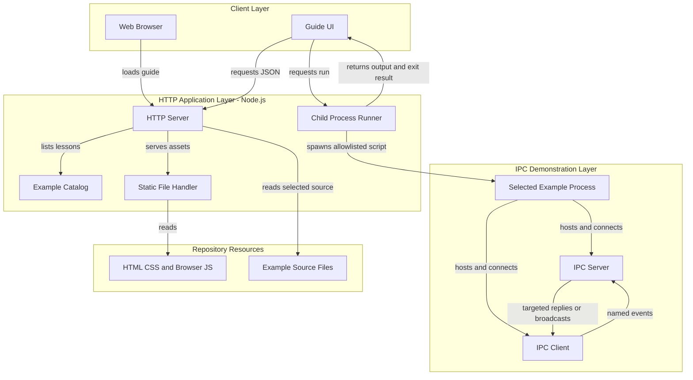
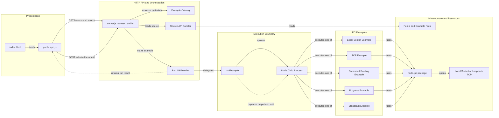
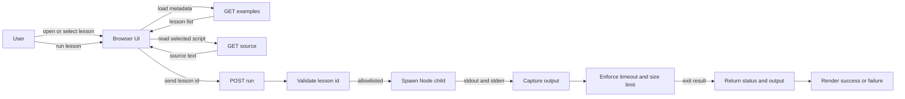

# Architecture Diagram

This document maps the interactive Node IPC guide from browser interaction through the HTTP server and into the child-process IPC demonstrations. It also traces the important request, response, and event-stream call paths for design review.

## Application Architecture

<!-- mermaid-checked: no \n, no em-dash/en-dash, no {} in labels, subgraphs are id["label"], arrows are -->|"label"|, all subgraphs closed by end, ids unique -->

### Technology Stack Summary

| Layer | Technology | Version | Purpose |
|---|---|---:|---|
| Browser UI | HTML, CSS, JavaScript | Browser native | Presents lessons, source code, run controls, and captured output |
| HTTP server | Node.js built-in HTTP | Node 18 minimum in the IPC guide | Serves the application and exposes the example catalog, source, and run APIs |
| Process control | Node.js child_process | Built in | Starts one allowlisted example process and captures its standard output and error streams |
| IPC transport | @node-ipc/node-ipc | 11.0.3 | Demonstrates local Unix or Windows sockets, TCP, targeted emits, progress events, and broadcasts |
| Example host | Node.js ESM | Current runtime | Runs each server and client demonstration in a bounded child process |
| Standalone exercise | TypeScript, tsx, Node test | TypeScript 5.9, Node 22 minimum | Supports the separate notes CLI project used by the learning guide |

### Data Storage & External Services

The interactive guide has no database or external runtime service. The catalog is an in-memory object in the HTTP server, browser assets and example source are read from the repository, and IPC endpoints are temporary local sockets or loopback TCP listeners. The standalone notes CLI is separate from the web runtime and persists note data to a JSON file.

### Key Architectural Decisions

- The browser cannot choose arbitrary scripts. Lesson identifiers are resolved through a fixed server-side catalog, then mapped to known example files.
- Each demonstration runs in a short-lived child process with captured output, a size limit, and a ten-second timeout, isolating the web server from the sample IPC lifecycle.
- The examples intentionally keep IPC local to the machine, using temporary local sockets or `127.0.0.1` TCP even where network transport is demonstrated.

## Component Relationships

<!-- mermaid-checked: no \n, no em-dash/en-dash, no {} in labels, subgraphs are id["label"], arrows are -->|"label"|, all subgraphs closed by end, ids unique -->

### Component Inventory

| Component | Layer | Type | Responsibility |
|---|---|---|---|
| index.html | Presentation | Static page | Defines the lesson navigator, source viewer, run controls, and output regions |
| public app.js | Presentation | Browser module | Loads catalog data, switches lessons, fetches source, and runs examples |
| server.js request handler | HTTP API and Orchestration | Node HTTP handler | Routes static, catalog, source, and run requests |
| Example Catalog | HTTP API and Orchestration | In-memory registry | Maps stable lesson IDs to titles, concepts, and allowlisted scripts |
| Run API handler | HTTP API and Orchestration | Route handler | Validates the selected lesson and delegates execution |
| Source API handler | HTTP API and Orchestration | Route handler | Reads source for a cataloged example |
| runExample | Execution Boundary | Process coordinator | Spawns Node, captures streams, enforces output and time limits, and reports completion |
| Node Child Process | Execution Boundary | Isolated process | Runs one IPC demonstration independently from the web server |
| Local Socket Example | IPC Examples | Demo process | Demonstrates one request and one targeted reply over a local socket |
| TCP Example | IPC Examples | Demo process | Demonstrates the same event exchange over loopback TCP |
| Command Routing Example | IPC Examples | Demo process | Validates math requests and correlates success or error responses by request ID |
| Progress Example | IPC Examples | Demo process | Emits multiple progress events followed by one completion event |
| Broadcast Example | IPC Examples | Demo process | Connects two clients and broadcasts the same notice to both |

## Call Flow Review

The diagrams below separate the browser-to-server orchestration flow from the internal IPC protocol flow. They show where validation, lifecycle control, and correlation occur.

### Guide Run Flow

<!-- mermaid-checked: no \n, no em-dash/en-dash, no {} in labels, subgraphs are id["label"], arrows are -->|"label"|, all subgraphs closed by end, ids unique -->

### IPC Request and Event Flow

```mermaid
flowchart LR
    subgraph fSetup["Process Setup"]
        fConfigure["Configure IPC id and transport"]
        fServe["Register server handlers"]
        fStart["Start IPC server"]
        fConnect["Connect client"]
        fReady["Receive connect event"]
    end
    subgraph fProtocol["Protocol Exchange"]
        fSend["Client emits named event"]
        fReceive["Server receives event and socket"]
        fCheck["Validate payload when required"]
        fReply["Emit targeted reply"]
        fProgress["Emit progress sequence"]
        fBroadcast["Broadcast to all clients"]
        fConsume["Client handles response events"]
    end
    subgraph fCleanup["Lifecycle"]
        fComplete["Correlation or completion condition"]
        fDisconnect["Disconnect clients"]
        fStop["Stop server"]
        fExit["Child exits"]
    end

    fConfigure --> fServe --> fStart --> fConnect --> fReady --> fSend
    fSend --> fReceive --> fCheck
    fCheck -->|"request response"| fReply
    fCheck -->|"long task"| fProgress
    fCheck -->|"multi-client update"| fBroadcast
    fReply --> fConsume
    fProgress --> fConsume
    fBroadcast --> fConsume
    fConsume --> fComplete --> fDisconnect --> fStop --> fExit
```

<!-- mermaid-checked: no \n, no em-dash/en-dash, no {} in labels, subgraphs are id["label"], arrows are -->|"label"|, all subgraphs closed by end, ids unique -->

### Review Notes

- Command responses are correlated with `requestId`; ordinary local-socket and TCP replies assume one active request and do not add application-level correlation.
- Progress events are emitted synchronously in the example, so the diagram represents protocol order rather than simulated elapsed work.
- The IPC server and client share one demonstration process in all current examples. Production designs may place them in separate processes, but the transport and event contract remain the same.
- The tutorial notes CLI is not part of the interactive IPC call graph and should be reviewed as a separate command-line application.
